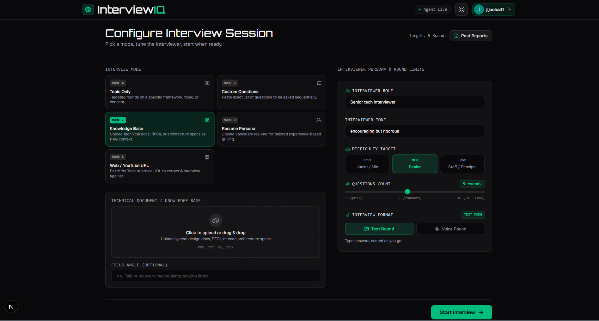
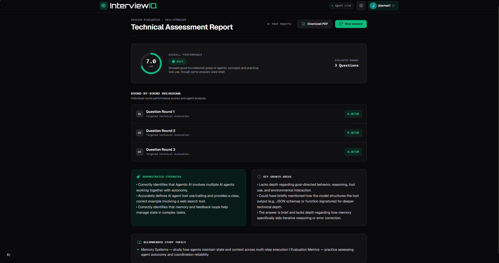

# InterviewIQ

An agentic AI interviewer that runs a real technical interview end to end: it picks the questions, adapts difficulty, scores every answer, delivers a hire verdict, and hands back a report that tells you what to study next.



**Live:** <https://interviewiq-frontend-pxp5.onrender.com> · Google sign-in required · free tier, so the first request can take ~50 s to wake the services.

---

## What it does

- **Five ways to start** — a topic, a list of questions, an uploaded knowledge base, your résumé, or a YouTube/web article link.
- **Real turn-based interview** — one question at a time over a WebSocket, answer in text or voice, difficulty shifts up or down based on the evaluation.
- **Per-answer scoring** — an evaluator agent returns a 0–10 score with strengths and gaps for every answer; the overall is computed in code, never invented by the model.
- **A report you can act on** — overall score, verdict, why that verdict, strengths, gaps, and a study plan, viewable in the browser or downloaded as a PDF.
- **Past reports** — every finished session is stored per user and listed newest-first.



*A finished session: the overall score, the verdict and why it was given, strengths, gaps, and what to study next.*

## Modes

| Mode | Label | Input | Retrieval |
| --- | --- | --- | --- |
| A | Topic Only | A topic, e.g. "Distributed Systems" | — |
| B | Custom Questions | Pasted question list (one per line) | — |
| C | Knowledge Base | Uploaded doc used as interview material | Pinecone |
| D | Resume Persona | Uploaded résumé, grilled on your own experience | Pinecone |
| E | Web / YouTube URL | Article text or video transcript | fetched on demand |

## How it works

```
Browser (Next.js 15)
  ├─ REST  ─────────────► FastAPI ──────► Firestore
  │   sessions, reports,                 scores + transcripts
  │   PDF, uploads                      + namespace owners
  └─ WebSocket ─────────► /ws/{session_id}
                            │
                            ▼
                     ADK Runner ──► interviewer_agent  (root, 0 sub-agents)
                                      ├─ question_generator  AgentTool
                                      │    └─ parse_file · fetch_url · upsert_document
                                      │       · retrieve_context ─────────────────► Pinecone
                                      ├─ evaluator           AgentTool
                                      ├─ store_questions / next_question   FunctionTools
                                      └─ save_score / save_transcript      FunctionTools ──► Firestore
                                            ▲
                              Gemini 3.5 Flash-Lite (AI Studio free tier)
```

Three agents total: `interviewer_agent` is the root; `question_generator` and `evaluator` are complete ADK agents mounted as `AgentTool`s, so they return structured data inside the same turn instead of transferring control. The root itself exposes no sub-agents (`sub_agents=[]`), which is what keeps the flow from stalling between turns.

A turn: the candidate answers → the evaluator returns `{score, strengths, gaps, signal}` → the interviewer asks the next banked question at the adjusted difficulty.

Design tradeoffs:

| Decision | Instead of | Why |
| --- | --- | --- |
| Agent tools, not sub-agents | A multi-agent handoff graph | Tool results return inside the same turn, so there is no boundary where an interview stalls mid-question. |
| Code computes the overall | Asking the model for a final number | The model judges answers; the arithmetic is deterministic (position × difficulty weights, bounded ±1 nudge), so the same answers always yield the same overall. |
| Probing disabled in every mode | Follow-up questions | A probe was either heard as a new question or silently stole a round, mis-attributing the score; one answer = one auditable round. |
| Report rebuilt from backend turn state | Trusting the agent's save calls | The Lite model skips tool calls; code truth keeps the transcript and report complete. |
| Browser STT/TTS over the socket | A server-side Live audio bridge | No audio pipeline and no extra quota; the cost is Chromium-centric speech recognition. |
| 404 for foreign resources | 403 | A 403 confirms the id exists; a 404 does not. |
| In-memory session state | Persisting every turn | No write per turn; the cost is that a restart drops in-flight interviews. |
| AI Studio + explicit fallback chain | Vertex AI | The $0 constraint; rate limits are absorbed by bounded retries and a shallow-copied fallback model. |

## API surface

Every REST endpoint except the health check requires a Firebase ID token. "Owner" means the resource must belong to the caller.

| Method | Path | Purpose | Auth |
| --- | --- | --- | --- |
| `POST` | `/sessions` | Create a session from mode + persona config | token |
| `GET` | `/sessions` | Past Reports for the caller, newest first | token |
| `DELETE` | `/sessions/{id}` | Delete one session's score + transcript (idempotent) | token + owner |
| `DELETE` | `/sessions` | Delete every session the caller owns | token |
| `GET` | `/sessions/{id}/report` | Report JSON: agent content + backend enrichment | token + owner |
| `GET` | `/sessions/{id}/report.pdf` | The same report as a PDF | token + owner |
| `POST` | `/upload` | Parse + embed a document, pin the namespace to the caller | token, ≤ 5 MB |
| `WS` | `/ws/{id}` | Interview loop: answers, tokens, scores, report signal | token frame in strict mode |
| `WS` | `/ws/audio/{id}` | Live audio bridge, parked behind `VOICE_LIVE_ENABLED` | disabled by default |
| `GET`/`HEAD` | `/healthz` | Dependency-free liveness probe for Render | public |

## Tech stack

| Layer | Choice |
| --- | --- |
| Frontend | Next.js 15 (App Router), React 19, Tailwind CSS 4, TypeScript |
| API | FastAPI + Uvicorn, REST + WebSocket |
| Agents | Google ADK 2.8 (`google-adk`) — one root agent, two agents mounted as tools, plus FunctionTools |
| Models | `gemini-3.5-flash-lite` via AI Studio, fallback chain `gemini-2.5-flash-lite` → `gemini-3.1-flash-lite` |
| Retrieval | Pinecone (hybrid: Gemini embeddings + hashed sparse vectors), 1,500-char chunks / 150 overlap |
| Data | Firestore (Spark) — scores, transcripts, namespace ownership |
| Auth | Firebase Auth (Google sign-in), ID tokens verified server-side |
| Voice | Browser Web Speech API (`SpeechRecognition`) + `speechSynthesis`, turn-based |
| Reports | fpdf2 server-side PDF; React + react-markdown in the UI |
| Tracing | Langfuse over native OTLP/HTTP (no SDK) — per-session and per-user traces, inert when keys are absent |

## Run it locally

Prerequisites: **Python 3.12**, **Docker**, **Node.js 20+**, and a free Google AI Studio key.

```bash
# 1. Backend (Docker keeps the runtime identical to production)
docker compose up --build          # http://localhost:8000 — health at /healthz

# 2. Frontend
cd frontend
npm install
npm run dev                        # http://localhost:3000
```

`interviewiq_agent/.env` supplies the backend secrets (never committed):

| Key | Purpose |
| --- | --- |
| `GOOGLE_API_KEY` | AI Studio key for Gemini |
| `GOOGLE_GENAI_USE_VERTEXAI` | must stay `FALSE` — AI Studio, not Vertex |
| `PINECONE_API_KEY`, `PINECONE_INDEX` | vector store for the upload-backed modes (C/D) |
| `FIREBASE_PROJECT_ID`, `FIREBASE_CLIENT_EMAIL`, `FIREBASE_PRIVATE_KEY` | Admin SDK: token verification + Firestore |
| `LANGFUSE_PUBLIC_KEY`, `LANGFUSE_SECRET_KEY`, `LANGFUSE_BASE_URL` | optional tracing; leave empty to disable |

Frontend needs one variable in `frontend/.env.local`:

```bash
NEXT_PUBLIC_API_URL=http://localhost:8000
```

Beyond that, the app is local-first: no billing account, no Vertex AI, no paid tier required.

> Forking it? The Firebase web config lives in `frontend/lib/firebase.ts` (public client config, safe to ship) and points at one specific project. Replace it with your own and add your dev/prod host to **Firebase → Authentication → Settings → Authorized domains**.

## Tests

```bash
python -m pytest -q                 # 61 deterministic tests — no network, no LLM, no quota (venv active)
python evals/eval.py                # live LLM eval (~8 calls); writes evals/results.json
cd frontend && npx tsc --noEmit     # type check
cd frontend && npm run build        # production build
```

The suite covers the scoring math, report ownership, PDF content, the question-bank contract, model fallback behaviour, and the upload/socket limits. `evals/eval.py` is the only thing that spends quota; it asserts scoring bands rather than exact values, because LLM judgment wobbles by design.

## Security model

Login is a full gate: logged out means the login screen, nothing else.

| Control | Behaviour |
| --- | --- |
| Token verification | Firebase ID token verified server-side (10 s clock skew allowance); `AUTH_MODE=strict` rejects missing tokens with 401 |
| Resource ownership | A report, PDF, or delete target belonging to another account answers **404**, so the route never confirms that a session id exists |
| Namespace ownership | Every upload is pinned to its uploader (`uploads/{namespace}`); a session cannot retrieve a knowledge base it does not own |
| Upload limits | 5 MB per file, `pdf` / `docx` / `txt` / `md`, refused before parsing or embedding |
| Concurrency | At most 3 simultaneous interviews (`MAX_CONCURRENT_INTERVIEWS`); reconnects reuse their own slot |
| WebSocket | In strict mode, an answer is refused until the socket presents a token matching the session owner |

Free-tier quota is a design constraint, not an afterthought: the upload cap and the interview slot guard exist to protect the shared Gemini/Pinecone/Render quotas from one runaway loop, which matters more than raw traffic volume.

## Deploy

`render.yaml` defines two free-tier services: `interviewiq-backend` (Docker, health check `/healthz`) and `interviewiq-frontend` (Node, `npm run build`), with secrets entered once in the dashboard. It also declares `AUTH_MODE=strict`, so a backend created from the blueprint starts locked down instead of falling back to open mode.

One thing that lives outside the blueprint on purpose:

**`NEXT_PUBLIC_API_URL` is baked in at build time.** Set it to the backend URL *before* building the frontend service, and rebuild after changing it.

Deploy order: point Render at the repo as a Blueprint → fill the `sync: false` secrets → set `FRONTEND_URL` on the backend (CORS) → set `NEXT_PUBLIC_API_URL` on the frontend and rebuild → add the frontend host to Firebase's authorized domains.

## Project layout

```
backend/            FastAPI app — REST, interview WebSocket, auth, PDF, tracing
interviewiq_agent/  ADK package — root agent, agent-tools, RAG, persistence
frontend/           Next.js app — setup, interview stage, report, past reports
tests/              deterministic pytest suite
evals/              live LLM eval with score bands
assets/             screenshots
```

## Roadmap

- **Per-user daily session cap** — bound total quota per account, not just simultaneous sessions.
- **Per-document chunk cap** — bound embedding cost by extracted text, independent of file size.
- **Neural TTS** — replace the browser `speechSynthesis` voice with a hosted neural voice (e.g. Gemini TTS on the AI Studio free tier) so every browser sounds the same and less robotic; today quality depends on whichever system voices the OS exposes.
- **UI polish pass** on the interview stage and report.
- **CI** — run pytest, `tsc`, and `next build` on every push.

## Known limitations

- Interview state lives in process memory (plus `InMemorySessionService`), so a container restart drops in-flight sessions. That is also why the concurrency guard is in-process: it is correct on one Render instance and would need Redis the moment there are two.
- Free-tier services sleep; expect a cold start on the first request.
- Speech input relies on the browser Web Speech API, which is Chromium-centric.
- Uploaded files are parsed, then embedded; the raw file lands on the container's ephemeral disk.

## Contributing

Issues and pull requests are welcome. Keep changes small and testable:

1. Fork the repo and branch off `main`.
2. Before opening a PR, run the deterministic suite and the type check:
   ```bash
   python -m pytest -q
   cd frontend && npx tsc --noEmit
   ```
3. `python evals/eval.py` spends real Gemini quota — run it when you touch prompts, scoring, or the model chain, not on every change.
4. No new services or dependencies that require billing; the project is built to stay inside free tiers.

Bug reports are most useful with the mode (A–E), what you typed or uploaded, and the backend log line if there is one.

## License

MIT — see [LICENSE](LICENSE).
